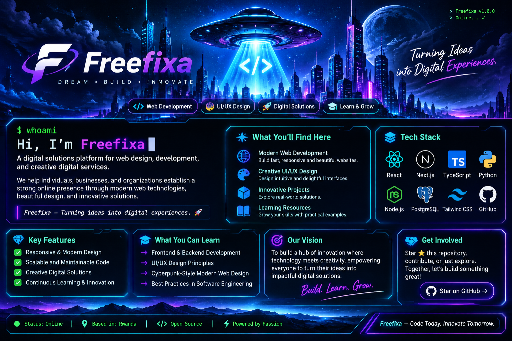

 <div align="center">



# ⚡ FREEFIXA

### `DREAM • BUILD • INNOVATE`

**Turning Ideas into Digital Experiences.**

[](https://developer.mozilla.org/en-US/docs/Web/HTML)
[](https://developer.mozilla.org/en-US/docs/Web/CSS)
[]()

</div>

---

## `01 // SYSTEM INITIALIZATION`

```bash
┌──(freefixa@system)-[~]
└─$ whoami

Freefixa

┌──(freefixa@system)-[~]
└─$ ./initialize.sh

[✓] Loading creativity...
[✓] Connecting design and technology...
[✓] Building digital experiences...
[✓] Preparing the interface...

SYSTEM STATUS: ONLINE
```

**Welcome to Freefixa.**

Freefixa is a creative web development project focused on building modern, visually appealing, and user-friendly digital experiences using HTML5 and CSS3.

The project explores how thoughtful design, clean code, and modern frontend techniques can transform ideas into engaging web experiences.

Our philosophy is simple: great ideas deserve great execution.

## `02 // PROJECT OVERVIEW`

| Area | Description |
|---|---|
| Web Development | Building structured web pages using HTML |
| CSS Engineering | Styling, layouts, animations and visual effects |
| UI/UX Design | Creating intuitive and visually consistent interfaces |
| Responsive Design | Adapting layouts to different screen sizes |
| Creative Development | Transforming concepts into digital experiences |

## `03 // TECHNOLOGY STACK`

Built using the fundamentals of frontend web development.

<div align="center">

[](https://developer.mozilla.org/en-US/docs/Web/HTML)
[](https://developer.mozilla.org/en-US/docs/Web/CSS)

</div>

**Core technologies:**

- HTML5 — semantic structure and web content.
- CSS3 — styling, layouts, transitions and animations.

## `04 // WHAT YOU CAN LEARN`

This project offers an opportunity to explore practical frontend development concepts.

**HTML5**
- Semantic HTML structure.
- Organizing web content.
- Accessible markup.
- Creating structured web pages.

**CSS3**
- Flexbox and CSS Grid.
- Responsive layouts.
- CSS animations and transitions.
- Positioning and visual hierarchy.
- Reusable styling patterns.

**Frontend Development**
- Translating designs into web interfaces.
- Organizing project files.
- Browser rendering and debugging.
- Improving usability and accessibility.
- Building consistent user experiences.

## `05 // DEVELOPMENT PHILOSOPHY`

```css
:root {
    --primary: #00e5ff;
    --secondary: #8a2be2;
    --background: #050816;
    --text: #ffffff;
}

* {
    box-sizing: border-box;
}

body {
    background: var(--background);
    color: var(--text);
    font-family: sans-serif;
}

.digital-experience {
    color: var(--primary);
    transition: 0.3s ease;
}

.digital-experience:hover {
    color: var(--secondary);
}
```

We believe good frontend development combines:

- Clean and understandable code.
- Consistent visual design.
- Responsive layouts.
- Attention to detail.
- Continuous improvement.

## `06 // PROJECT VISION`

Our vision is to explore the possibilities of web technology and create digital experiences that combine creativity with functionality.

We believe that a good website should not only look impressive but should also communicate clearly, work effectively, and provide a meaningful experience.

**Think beyond the interface. Engineer the experience.**

## `07 // EXPLORE & CONTRIBUTE`

Want to explore the project?

1. Clone or download the repository.
2. Open the project in your preferred code editor.
3. Explore the HTML structure.
4. Study the CSS styling and layout.
5. Experiment with your own improvements.

Contributions, suggestions, and constructive feedback are welcome.

---

<div align="center">

### `SYSTEM STATUS: OPERATIONAL`

**FREEFIXA**

`DREAM. BUILD. INNOVATE.`

*Code Today. Innovate Tomorrow.*

🌍 Built with creativity, HTML and CSS.

</div>
